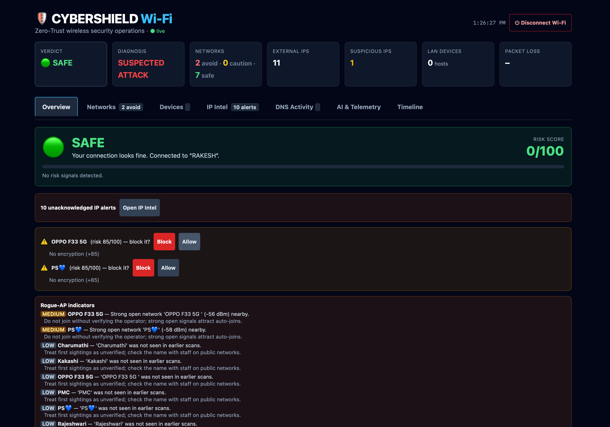
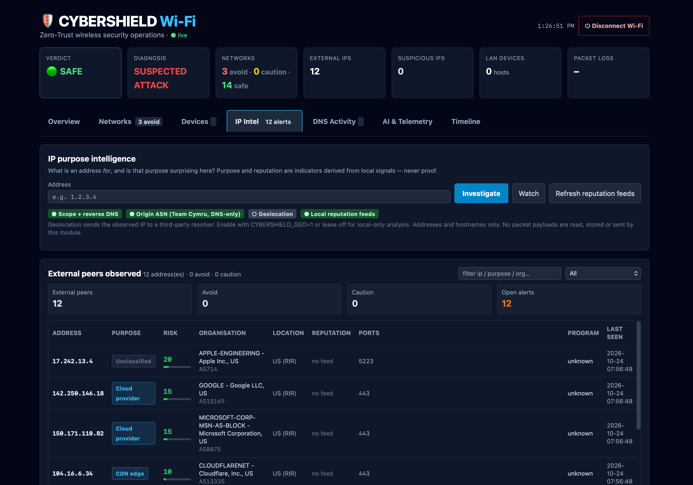

# 🔐 CyberShield Wi-Fi

**A local-first, zero-trust Wi-Fi security dashboard: live connection checks, nearby-network risk, LAN device discovery, IP purpose intelligence and opt-in NextDNS activity.**

> A Wi-Fi device is not permanently trusted just because it authenticated.



---

## What it does

CyberShield inspects the network the host is actually connected to, using live host telemetry only.

| | Live mode |
|---|---|
| Data | Your real Wi-Fi |
| Needs | macOS, Windows or Linux with the platform's Wi-Fi tools |
| Can change your system? | Only when you confirm (block, disconnect) |
| Where it runs | On your own machine, locally |

**Live mode is the point of the project.** A container cannot inspect the host's Wi-Fi, ARP table or packets, so Docker is only a UI/API preview.

**Four pillars:** Authenticate → Authorize → Detect → Respond

### Live mode, in one screen



Every external address the host is talking to is classified by *what it is for* — CDN edge, cloud provider, hosting, Tor exit, resolver, tracker — and scored in context. See [IP purpose intelligence](#ip-purpose-intelligence) below.

---

## Quick start

**Python** (the primary way to run it):

```bash
cd backend
pip install -r requirements.txt
uvicorn main:app --reload --port 8000
# open http://127.0.0.1:8000
```

**npm** (a thin wrapper around exactly the same command, if you prefer Node tooling):

```bash
npm install
npm start          # http://127.0.0.1:8000
```

**Docker** — container preview:

```bash
docker compose up --build
# open http://127.0.0.1:8000
```

> A container has no access to your real Wi-Fi, ARP table or packets. Live host panels will report "unavailable on this host"; use `./run.sh` on your own machine for live checks and collection.

### Phone view (optional)

By default the server only listens on `127.0.0.1`, so only that machine can reach it. To open the dashboard from a phone on the same Wi-Fi, opt in explicitly:

```bash
CYBERSHIELD_HOST=0.0.0.0 \
CYBERSHIELD_ALLOWED_HOSTS=<your-computer-ip> \
CYBERSHIELD_ALLOWED_ORIGINS=http://<your-computer-ip>:8000 \
npm start
```

Only do this on a network you trust, and read [Security and privacy](#security-and-privacy) first.

### Configuration

Every setting is optional and the defaults are the safe ones. Copy `.env.example` to `.env` and export what you need.

| Variable | Default | What it does |
|---|---|---|
| `CYBERSHIELD_HOST` | `127.0.0.1` | Bind address. Change to `0.0.0.0` only deliberately. |
| `PORT` | `8000` | Port to listen on. |
| `CYBERSHIELD_ALLOWED_HOSTS` | `127.0.0.1,localhost,::1` | Extra hostnames/IPs allowed to reach the server (`Host` header check). |
| `CYBERSHIELD_ALLOWED_ORIGINS` | `http://127.0.0.1:8000,http://localhost:8000` | Extra browser origins allowed to call the API (CORS). |
| `CYBERSHIELD_TOKEN` | random per start | Fixed session token for state-changing requests. |
| `CYBERSHIELD_GEO` | `0` | Set to `1` to enable geolocation — the only IP-intelligence step that contacts a third party. |
| `NEXTDNS_API_KEY` | unset | Opt-in: read a consented NextDNS profile's query log. Keep it backend-only. |
| `NEXTDNS_PROFILE_ID` | unset | Opt-in: the NextDNS profile whose logs are ingested. |
| `NEXTDNS_POLL_SECONDS` | `60` | Background sync interval when a profile is connected (minimum 15). |
| `DNS_RETENTION_DAYS` | `30` | How long CyberShield keeps its local DNS event copy. |
| `NEXTDNS_BASE_URL` | `https://api.nextdns.io` | Override only for testing or a compatible self-hosted endpoint. |

---

## Architecture

```
             ┌────────────────────── COLLECTION ──────────────────────┐
             │                                                          │
  macOS      │  system_profiler · networksetup · ipconfig · route     │
  Windows    │  netsh wlan · route print · ipconfig · arp · ping       │
  Linux      │  iw · nmcli · ip route · /etc/resolv.conf · arp · ping │
             └───────────────────────────┬──────────────────────────────┘
                                         │
              ┌──────────────────────────┴──────────────────────────┐
              │  real_net.py        link · nearby APs · IP/gw/DNS  │
              │                     LAN census (ARP / ping sweep) │
              │  packet_monitor.py  gateway loss probe · flow      │
              │                     counters · peer IP + port +     │
              │                     local program · bounded PCAP   │
              └──────────────────────────┬──────────────────────────┘
                                         │
        ┌────────────────┬───────────────┼───────────────┬─────────────────┐
        ▼                ▼               ▼               ▼                 ▼
   policy.py      threat_model.py   rogue.py      diagnosis.py      ai_detector.py
   network score  threat catalog   AP change     attack vs fault   Isolation Forest
   + enforcement  + proximity      warnings      + evidence        (corroboration)
                                        │
                             ┌──────────┴───────────┐
                             ▼                      ▼
                      ip_intel.py              ip_purpose.py
                      scope · rDNS · ASN       purpose label
                      · opt-in geo · feeds     + context score
                             │                      │
                             └──────────┬───────────┘
                                        ▼
                                 ip_alerts.py · ip_report.py
                                 alerts + investigation reports
                                        │
        ┌───────────────────────────────┴───────────────────────────────┐
        ▼                                                               ▼
  FastAPI (main.py) + security.py                         SQLite (database.py)
  restricted CORS · Host allow-list · session token       events · incidents · DNS
        │                                                     health · IP intel
        ▼
  Single-page dashboard (frontend/index.html)
```

**Separate scoring paths, and they do not overlap:**

- **Network risk** — deterministic rules over what a network advertises (security class, twin indicators, signal). No model involved.
- **IP purpose risk** — deterministic rules over purpose, local actor and behaviour.
- **Live-environment anomaly** — an Isolation Forest corroborates the live snapshot; it never overrides a rule.

The Isolation Forest is reported next to the rule result so a human can see when they agree and when they do not.

---

## Ask first, never silent

Every radar scan lists networks scoring 65 or higher as **avoid**, with Block and Allow buttons. Nothing is forgotten or blocked until you confirm. Every warning is an indicator, not proof.

| Network | Verdict | Score |
|---|---|---|
| Open | avoid | 85 |
| WEP | avoid | 92 |
| WPA (v1) | avoid | 75 |
| Unknown | caution | 60 |
| WPA2 | connect | 15 |
| WPA3 | connect | 5 |

Block removes the saved network so the host will not auto-join it (`networksetup` on macOS, `nmcli` on Linux, `netsh` on Windows) and records it in a blocklist. Allow records it in an allowlist. Disconnect turns Wi-Fi off — manual and confirmed only, never automatic.

---

## IP purpose intelligence

**What is this address *for* — and is that purpose surprising *here*?**

A hosting address contacted by a browser during a page load is ordinary. The same address contacted by an unrecognised program at 03:00 is a finding. A purpose on its own is never a verdict, so the score is always **purpose × local actor × behaviour**.

### Where the data comes from

| Signal | Source | Leaves the host? | Default |
|---|---|---|---|
| Scope (public / private / loopback / link-local / multicast / CGNAT) | computed locally | No | Always on |
| Reverse DNS | local resolver, hard deadline | No | Always on |
| Origin ASN, prefix, RIR, AS name | Team Cymru's DNS interface | No — DNS only, no key, no account | Always on |
| Reputation match | locally downloaded feed files | No | Always on |
| Geolocation, city, ISP | third-party resolver | **Yes** | **Off** |

Geolocation is off unless `CYBERSHIELD_GEO=1`, because it is the only step that puts an observed address in front of another party. The dashboard always shows which enrichers are active. Reputation is matched locally, so a raw observed address is never handed to a reputation API.

Reputation feeds (Tor exit nodes, FireHOL level 1, FireHOL anonymisers) download one-way into the OS temp directory. A feed that cannot be fetched is reported as **unavailable**, never treated as clean. TLS verification is never disabled — an unauthenticated feed could inject arbitrary addresses into the list and every match would then be a false positive.

### Purposes

`loopback` · `lan-peer` · `gateway` · `dns-resolver` · `public-dns` · `ntp` · `mdns` · `dhcp` · `cdn` · `cloud-provider` · `hosting` · `vps` · `bulletproof-hosting` · `tor-exit` · `vpn-exit` · `proxy` · `tracker` · `mail` · `update-distribution` · `streaming` · `game-server` · `web-app` · `unknown`

Shared infrastructure (CDN, cloud) is classified but never treated as hostile on its own — attributing traffic to a CDN edge tells you nothing about the actor behind it.

### Alerts

Alerts are indicators surfaced for the operator, never autonomous actions. The host cannot block an external address, so every recommended action is one a person can take. Each alert cites the observations that produced it and carries a dedup cooldown.

| Alert | Severity | Trigger |
|---|---|---|
| `bulletproof_host` | critical | Connection to a bulletproof hosting provider |
| `tor_exit_contact` | high | Traffic reached a Tor exit node |
| `reputation_malware` | high | Address matched a malware or botnet feed |
| `scan_shape` | high | One remote address contacted across 5+ distinct ports |
| `beaconing` | high | Regular interval connection pattern |
| `unexpected_hosting` | medium | Unrecognised program contacted hosting infrastructure |
| `watchlist_hit` | medium | A watched address was contacted |
| `new_external_ip` | info | First contact with a new external address |

### Reports

`GET /api/ip/report?ip=…&format=md|json|csv` builds an investigation report from data already stored on this host: summary and verdict, the reasoning behind the score, address facts, reputation matches, observed behaviour, related alerts, recommended actions, and an explicit method-and-limits section naming the enrichment sources used and the ones unavailable. The dashboard downloads it as Markdown, JSON or CSV.

---

## Network intelligence: consented DNS activity

This is the **only** way to see domain activity from devices other than the machine running CyberShield, and it is deliberately opt-in.

A laptop connected to a phone hotspot is just another client. The hotspot forwards traffic to the internet, so a packet capture on the laptop sees the laptop's own traffic — not the phone's, and not another guest's. CyberShield does not pretend otherwise. Instead, a participant can explicitly configure their device to use a **NextDNS** profile that CyberShield is allowed to read.

### Setup

1. Create a profile at [nextdns.io](https://nextdns.io) and enable query logging. Copy the API key from the account page and the profile ID from the profile's **Setup** page.
2. Open **DNS Activity** and use **Connect & test**. The backend verifies the credentials with NextDNS before saving them to `~/.cybershield/nextdns.json` with owner-only permissions (mode `0600`). It then starts a background sync every `NEXTDNS_POLL_SECONDS` (default 60).

   The environment-variable path still works and is preferable on a shared or managed host. Add both values to `.env`, export it, and restart the backend:

   ```bash
   NEXTDNS_API_KEY=your-private-api-key
   NEXTDNS_PROFILE_ID=your-profile-id
   ```

   For safety, the setup form accepts credentials only from the machine running CyberShield (loopback). From another device on the same network, set the environment variables on the host instead. The same applies in the Docker preview, where requests arrive through Docker's bridge rather than loopback.

3. On each consenting device, set Private DNS / DNS-over-TLS to:

   ```
   <device-name>-<profile-id>.dns.nextdns.io
   ```

   The device name is how the participant appears in the dashboard; use simple letters, digits and hyphens. For example, `Friend-Phone-abc123.dns.nextdns.io` shows up as `Friend-Phone`.

4. Open the **DNS Activity** tab. The dashboard polls every 10 seconds; the backend caches NextDNS responses for 12 seconds and also syncs in the background, so events arrive even when the tab is closed.

Never commit the API key or paste it into a screenshot, chat, or third-party website. The setup form sends it once to the local backend; the key is never returned by an endpoint.

### What appears

| Field | Meaning |
|---|---|
| Device | NextDNS device name, or the client name/IP if no name was configured |
| Domain / root | The name that was looked up |
| Protocol | DNS transport reported by NextDNS (DoT, DoH, UDP, …) |
| Status | `default`, `allowed`, or `blocked` |
| Indicator | `normal`, `watch`, `suspicious`, or `alert`, with the reason |

Indicators are intentionally conservative and transparent: punycode, raw-IP hostnames, long high-entropy labels, unusually deep names, high-abuse TLDs, Tor `.onion` names, and blocklist reasons reported by NextDNS. These are prompts to investigate, not proof of compromise. A blocked lookup is a policy outcome, not automatically an attack.

### History and control

- Events are stored in the local SQLite database for `DNS_RETENTION_DAYS` (default 30) so device timelines and searches survive NextDNS log rollover.
- **Disconnect profile** removes the stored credentials but keeps local history. **Clear local history** deletes CyberShield's copy and pauses ingestion; press **Refresh** to resume. NextDNS keeps its own copy according to that profile's retention settings.
- Removing the Private DNS setting on a device stops that device from appearing. Monitoring is visible to participants by design.

### Limits

DNS logging shows **lookups**, not page views. Cached answers produce no new event, and HTTPS content, URLs after the domain, searches, passwords and messages are never visible. VPNs, private DNS resolvers, apps with their own resolver, and background app/analytics traffic all affect coverage. A domain in the table does not prove that someone deliberately opened that website.

---

## API

All `POST`, `PUT`, `PATCH` and `DELETE` requests need the header `X-CyberShield-Token`. The dashboard fetches it from `GET /api/session` automatically.

**Live**

- `GET /api/health` — lightweight liveness probe
- `GET /api/real/status` — SSID, security, signal, IP/gateway/DNS, protocol checks, risk 0–100, verdict
- `GET /api/real/networks` — nearby networks with signal and security
- `GET /api/real/devices?mode=fast|full` — LAN devices via ARP (fast) or ping sweep (full)
- `POST /api/real/scan` — deeper ping sweep of your /24 (about 10 s)
- `GET /api/real/radar` — nearby networks, proximity zone, verdict, threats, pending blocks
- `POST /api/real/block` · `/unblock` — forget or allow a network
- `POST /api/real/disconnect` — turn Wi-Fi off (manual emergency only)
- `POST /api/real/device/flag` — flag a LAN device
- `GET /api/policy` — auto-protect state and block/allow/flag lists
- `GET /api/real/timeline` · `/health/history` · `/verify` — chronology and before/after comparison
- `GET /api/real/packet` · `POST /api/real/packet/probe` — loss and flow telemetry
- `GET /api/real/capture/status` · `POST /api/real/capture/start` · `/stop` · `/download`

**IP purpose intelligence**

- `GET /api/ip/observed` — every external address with purpose, score, verdict and reasons
- `GET /api/ip/lookup?ip=…` — full intelligence payload for one address
- `GET /api/ip/alerts` · `POST /api/ip/alerts/{id}/ack`
- `GET`/`POST`/`DELETE /api/ip/watch` — watchlist
- `GET /api/ip/report?ip=…&format=md|json|csv`
- `GET /api/ip/feeds/status` · `POST /api/ip/feeds/refresh`
- `GET /api/ip/sources` — which enrichers are enabled and what each one sends off-host

**Consented DNS activity**

- `GET /api/network/status` — configured? source, last sync, last error, retention, consent note
- `POST /api/network/connect` — verify and store credentials; loopback only; body `{"api_key":"…","profile_id":"…"}`
- `DELETE /api/network/connect` — forget locally stored credentials, keeping history
- `GET /api/network/overview?hours=24&limit=100&device=…&q=…&severity=flagged` — stats, participants, top domains and events
- `GET /api/network/events` — the same event query without the dashboard aggregates
- `GET /api/network/devices` · `/api/network/device/{name}` — participant summaries and timeline
- `GET /api/network/domains` — most-requested domains
- `POST /api/network/refresh` — force a NextDNS fetch (also resumes ingestion after a purge)
- `DELETE /api/network/history` — clear the local copy and pause ingestion

---

## Security and privacy

- **Listens on `127.0.0.1` only by default.** Binding to `0.0.0.0` is an explicit opt-in.
- **CORS is restricted** to the dashboard's own origin. `*` is never accepted.
- **The `Host` header is checked** against an allow-list, which blocks DNS-rebinding attacks where a malicious hostname resolves to `127.0.0.1`.
- **State-changing endpoints need a per-session token.** Without it, any web page you visit while the dashboard is running could turn off your Wi-Fi, delete a saved network, or start a packet capture. The dashboard fetches the token from `GET /api/session`, which other origins cannot read.
- **Packet capture is headers only, never payloads.** Snap length is 128 bytes: link, network and transport headers, with payloads truncated at capture time. Captures are size-, time- and packet-bounded, kept in the OS temp directory, and deleted automatically after 15 minutes.
- **No packet payload is ever read, stored or sent** by any part of this tool. Flow telemetry comes from socket and interface counters.
- **Geolocation is off by default**, and it is the only IP-intelligence feature that sends an observed address to a third party. The dashboard states which enrichers are active.
- **Reputation matching is local.** Lists are downloaded one-way and matched on your machine; raw observed addresses are never sent to a reputation API.
- **Local credentials are still local secrets.** The `0600` file protects against other OS users, not against malware or any process running as your account. Prefer environment variables or a secret manager on a shared host.
- **Local DNS history is sensitive and sits in the same unencrypted SQLite file as the rest of the app.** Use full-disk encryption on a laptop, and remember that anyone who can read that file can see the domains that were looked up.
- **DNS activity is opt-in and consent-based.** It works only for devices whose owners explicitly configured the CyberShield NextDNS profile. The API key is read from the environment or a `0600` local config, never returned by an endpoint, and never included in a status response. The credential form is loopback-only; a visible control disconnects the profile, and another clears the local copy and pauses ingestion. NextDNS still sees the DNS queries it resolves — that is inherent to using it as a resolver.

---

## Limitations and privacy

**Limitations**

- Live mode is exercised on macOS; Windows and Linux collectors exist and follow the same shape, but the macOS path is the most tested.
- This is a prototype, not a replacement for a firewall or IDS. The live host collectors observe one machine; the separate opt-in DNS feature only sees devices that use the configured NextDNS profile.
- Risk scores are heuristics. A high score means "look at this", not "this is an attack".
- The Isolation Forest is trained on small synthetic samples, not on your environment. Treat its output as corroboration, never as ground truth.
- Blocking prevents future auto-joins. It does not drop the current session and does not affect other devices.
- Real device isolation needs a **MAC block on your router**. CyberShield can flag a device and record it, but it cannot block it from the host by itself.
- The socket table shows *current* connections. A connection that opened and closed between polls is never observed.
- Proximity is an RSSI heuristic, not ranging.
- LAN sweeps see only hosts that answer ARP or ping.
- Twin detection compares security and channel fingerprints, not BSSIDs, so a perfect clone is not distinguishable from the legitimate AP by these signals alone.
- IP purpose classification is heuristic: a hosting provider that also runs a CDN is classified as a CDN, and an address matching no rule stays `unknown` rather than being guessed.
- **DNS Activity cannot see another device unless that device uses the configured NextDNS profile.** A hotspot host cannot silently observe guests' browsing. VPNs, private resolvers, apps with their own DNS, cached answers and background traffic all reduce coverage. DNS logs show lookups, not page views; HTTPS content is never visible. Indicators are heuristics, not proof of compromise. Clearing local history does not delete NextDNS's own copy. Background sync runs only while the backend is running, a profile is connected, and ingestion is not paused.

**Privacy**

- **Headers only, never payloads.** The PCAP path truncates at 128 bytes at capture time.
- Collectors read: Wi-Fi link and scan results, IP/gateway/DNS, ARP table, interface and socket counters, and the names of local processes. Nothing else.
- The socket table is used to attribute a connection to a local program. Only the program *name* is read — no arguments, no file contents.
- Addresses, ports, hostnames and organisation names are stored in a local SQLite file. IP telemetry is never uploaded. The opt-in DNS feature downloads logs from NextDNS; it does not upload packet data or browsing content. If you connect a profile in the dashboard, the API key is stored locally at `~/.cybershield/nextdns.json` with owner-only permissions; it is sent only to NextDNS.
- Local program attribution needs `lsof` on macOS and Linux (`brew install lsof` / `sudo apt install lsof`). Without it, connections show as `unknown`.

---

## Project layout

```
backend/          FastAPI app, risk engine, live Wi-Fi checks, IP intelligence, DNS activity
frontend/         Single-page dashboard (Tailwind via CDN, no build step)
tests/            unittest suite for the risk, scoring, IP, DNS and security layers
tools/            Screenshot and image helpers (Swift + Python)
docs/             Screenshots
run.sh            Start script (macOS, Linux)
run.bat           Start script (Windows)
```

---

## Development

```bash
npm run setup        # install Python dependencies
npm run test         # python3 -m unittest discover -s tests -v
npm run dev          # uvicorn with --reload
npm run health       # is the server up?
```

Tests also run in CI on every push, across Linux, macOS and Windows.

---

## Roadmap

- [x] Tests and CI
- [x] Sparklines for signal, loss and latency
- [x] Search, sort and filter on tables
- [x] IP Purpose Intelligence (reverse DNS, ASN/ISP via Team Cymru, purpose labels, alerts, reports)
- [x] Consented network-wide DNS activity via NextDNS (device mapping, indicators, local retention, purge/pause)
- [x] Device vendor lookup from the MAC address
- [x] Export reports as Markdown, JSON or CSV
- [x] Docker container preview
- [ ] LAN device history over time
- [ ] Optional pluggable LLM summariser for reports (off by default, user-supplied endpoint)

---

## License

MIT — see [LICENSE](LICENSE).
