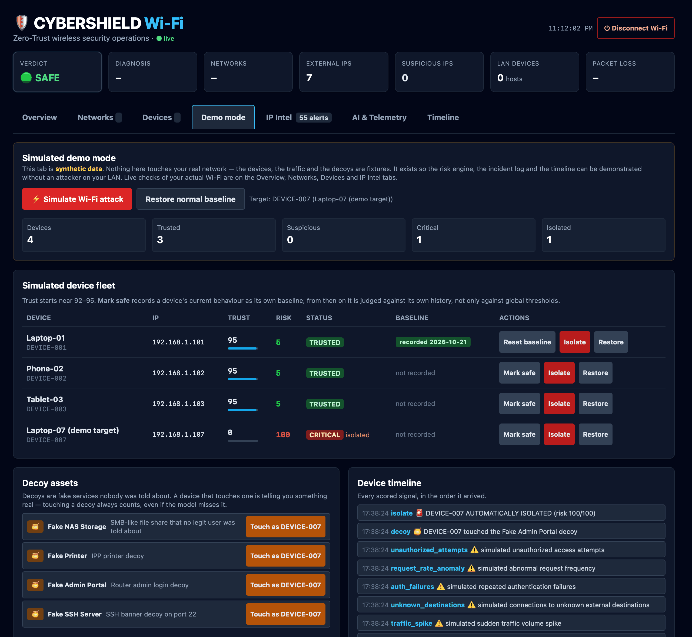

# 🔐 CyberShield Wi-Fi

**A zero-trust Wi-Fi security prototype: a rule-based risk engine with an Isolation Forest anomaly check, plus a live check of your own Wi-Fi.**

> A Wi-Fi device is not permanently trusted just because it authenticated.


---

## What it does

CyberShield has two modes. Keep them straight.

| | Simulated demo | Live mode |
|---|---|---|
| Data | Fake device telemetry + decoy network | Your real Wi-Fi |
| Needs | Any OS with Python 3.12+ | macOS, Windows or Linux with the platform's Wi-Fi tools |
| Good for | Demos, viva, presentations | Checking the network you are on |
| Can change your system? | No | Only when you confirm (block, disconnect) |
| Where it runs | Anywhere, including Docker | On your own machine, locally |

**Live mode is the point of the project.** The simulated mode exists so the risk engine, the incident log and the timeline can be demonstrated without an attacker on your LAN. It is labelled as synthetic in the dashboard, and it never touches your real network.

**Four pillars:** Authenticate → Authorize → Detect → Respond

### Live mode, in one screen


Every external address the host is talking to is classified by *what it is for* — CDN edge, cloud provider, hosting, Tor exit, resolver, tracker — and scored in context. See [IP purpose intelligence](#ip-purpose-intelligence) below.

---

## Quick start

**Python** (the primary way to run it):

```bash
cd backend
pip install -r requirements.txt
uvicorn main:app --reload --port 8000
# open http://127.0.0.1:8000
```

**npm** (a thin wrapper around exactly the same command, if you prefer Node tooling):

```bash
npm install
npm start          # http://127.0.0.1:8000
```

**Docker** — simulated demo mode only:

```bash
docker compose up --build
# open http://127.0.0.1:8000
```

> A container has no access to your real Wi-Fi, ARP table or packets, so the Docker image runs the **simulated** mode. Use `./run.sh` on your own machine for live mode.

### Phone view (optional)

By default the server only listens on `127.0.0.1`, so only that machine can reach it. To open the dashboard from a phone on the same Wi-Fi, opt in explicitly:

```bash
CYBERSHIELD_HOST=0.0.0.0 \
CYBERSHIELD_ALLOWED_HOSTS=<your-computer-ip> \
CYBERSHIELD_ALLOWED_ORIGINS=http://<your-computer-ip>:8000 \
npm start
```

Only do this on a network you trust, and read [Security and privacy](#security-and-privacy) first.

### Configuration

Every setting is optional and the defaults are the safe ones. Copy `.env.example` to `.env` and export what you need.

| Variable | Default | What it does |
|---|---|---|
| `CYBERSHIELD_HOST` | `127.0.0.1` | Bind address. Change to `0.0.0.0` only deliberately. |
| `PORT` | `8000` | Port to listen on. |
| `CYBERSHIELD_ALLOWED_HOSTS` | `127.0.0.1,localhost,::1` | Extra hostnames/IPs allowed to reach the server (`Host` header check). |
| `CYBERSHIELD_ALLOWED_ORIGINS` | `http://127.0.0.1:8000,http://localhost:8000` | Extra browser origins allowed to call the API (CORS). |
| `CYBERSHIELD_TOKEN` | random per start | Fixed session token for state-changing requests. |
| `CYBERSHIELD_GEO` | `0` | Set to `1` to enable geolocation — the only step that contacts a third party. |

---

## 2–3 minute demo

1. Open the dashboard and go to the **Demo mode** tab. All four devices are TRUSTED, trust around 92–95.
2. Click **Simulate Wi-Fi attack** (target DEVICE-007).
3. Watch the risk score climb one signal at a time: port scan → traffic spike → unknown destination → auth failures → request anomaly → unauthorised attempts → 🍯 decoy touch.
4. Risk reaches 100/100, status goes CRITICAL, and the device is quarantined. The timeline shows every scored signal with the evidence that produced it.
5. Click **Restore** to lift the quarantine, or try a manual **Isolate**.



> What "quarantine" means: in the simulated mode the device's row is marked isolated and its access is revoked **in the demo model**. No real traffic is blocked. Isolating a real device needs a MAC block on your router — see [Limitations](#limitations).

---

## Architecture

```
             ┌────────────────────── COLLECTION ──────────────────────┐
             │                                                          │
  macOS      │  system_profiler · networksetup · ipconfig · route     │
  Windows    │  netsh wlan · route print · ipconfig · arp · ping       │
  Linux      │  iw · nmcli · ip route · /etc/resolv.conf · arp · ping │
             └───────────────────────────┬──────────────────────────────┘
                                         │
              ┌──────────────────────────┴──────────────────────────┐
              │  real_net.py        link · nearby APs · IP/gw/DNS  │
              │                     LAN census (ARP / ping sweep) │
              │  packet_monitor.py  gateway loss probe · flow      │
              │                     counters · peer IP + port +     │
              │                     local program · bounded PCAP   │
              └──────────────────────────┬──────────────────────────┘
                                         │
        ┌────────────────┬───────────────┼───────────────┬─────────────────┐
        ▼                ▼               ▼               ▼                 ▼
   policy.py      threat_model.py   rogue.py      diagnosis.py      ai_detector.py
   network score  threat catalog   AP change     attack vs fault   Isolation Forest
   + enforcement  + proximity      warnings      + evidence        (corroboration)
                                        │
                             ┌──────────┴───────────┐
                             ▼                      ▼
                      ip_intel.py              ip_purpose.py
                      scope · rDNS · ASN       purpose label
                      · opt-in geo · feeds     + context score
                             │                      │
                             └──────────┬───────────┘
                                        ▼
                                 ip_alerts.py · ip_report.py
                                 alerts + investigation reports
                                        │
        ┌───────────────────────────────┴───────────────────────────────┐
        ▼                                                               ▼
  FastAPI (main.py) + security.py                         SQLite (database.py)
  restricted CORS · Host allow-list · session token       devices · events · incidents
        │                                                     health · IP intel
        ▼
  Single-page dashboard (frontend/index.html)
```

**Two separate scoring paths, and they do not overlap:**

- **Network risk** — deterministic rules over what a network advertises (security class, twin indicators, signal). No model involved.
- **Device behaviour risk** — deterministic rules over stored counters, with an Isolation Forest as *corroboration only*. The rules stay authoritative.
- **IP purpose risk** — deterministic rules over purpose, local actor and behaviour. Again, no model in the decision path.

The Isolation Forest never overrides a rule. It is reported next to the rule result so a human can see when they agree and when they do not.

---

## How the risk engine works

Rules decide first. AI only supports them.

| Signal | Points |
|---|---|
| Auth failures > 5 | +20 |
| Unknown destination | +20 |
| Port scan | +30 |
| Traffic spike | +15 |
| Request anomaly | +15 |
| Decoy hit | +40 (per hit) |
| Unauthorized access | +20 |
| Deviation from this device's own baseline | +15 |

Total is capped at 100.

| Score | Level |
|---|---|
| 0–30 | Trusted |
| 31–60 | Suspicious |
| 61–80 | High |
| 81–100 | Critical (auto-quarantine in simulated mode) |

**The AI part:** an Isolation Forest looks at connections, unique destinations, port attempts, request frequency and traffic volume. If scikit-learn is missing, the app falls back to rules only. A decoy hit always counts, even if the model misses it. The word "AI" in this project refers only to these models — the reports and summaries are rule-generated and are not described as AI-generated.

### Per-device baselines

**Mark safe** records a device's current behaviour as its own baseline. From then on the device is judged against its own history, not only against global thresholds: a busy device that suddenly starts scanning is more interesting than a quiet device that never does anything. Drift is measured in multiples of the recorded profile, so a busy device is not punished for being busy.

---

## Live mode: ask first, never silent

Every radar scan lists networks scoring 65 or higher as **avoid**, with Block and Allow buttons. Nothing is forgotten or blocked until you confirm. Every warning is an indicator, not proof.

| Network | Verdict | Score |
|---|---|---|
| Open | avoid | 85 |
| WEP | avoid | 92 |
| WPA (v1) | avoid | 75 |
| Unknown | caution | 60 |
| WPA2 | connect | 15 |
| WPA3 | connect | 5 |

Block removes the saved network so the host will not auto-join it (`networksetup` on macOS, `nmcli` on Linux, `netsh` on Windows) and records it in a blocklist. Allow records it in an allowlist. Disconnect turns Wi-Fi off — manual and confirmed only, never automatic.

---

## IP purpose intelligence

**What is this address *for* — and is that purpose surprising *here*?**

A hosting address contacted by a browser during a page load is ordinary. The same address contacted by an unrecognised program at 03:00 is a finding. A purpose on its own is never a verdict, so the score is always **purpose × local actor × behaviour**.

### Where the data comes from

| Signal | Source | Leaves the host? | Default |
|---|---|---|---|
| Scope (public / private / loopback / link-local / multicast / CGNAT) | computed locally | No | Always on |
| Reverse DNS | local resolver, hard deadline | No | Always on |
| Origin ASN, prefix, RIR, AS name | Team Cymru's DNS interface | No — DNS only, no key, no account | Always on |
| Reputation match | locally downloaded feed files | No | Always on |
| Geolocation, city, ISP | third-party resolver | **Yes** | **Off** |

Geolocation is off unless `CYBERSHIELD_GEO=1`, because it is the only step that puts an observed address in front of another party. The dashboard always shows which enrichers are active. Reputation is matched locally, so a raw observed address is never handed to a reputation API.

Reputation feeds (Tor exit nodes, FireHOL level 1, FireHOL anonymisers) download one-way into the OS temp directory. A feed that cannot be fetched is reported as **unavailable**, never treated as clean. TLS verification is never disabled — an unauthenticated feed could inject arbitrary addresses into the list and every match would then be a false positive.

### Purposes

`loopback` · `lan-peer` · `gateway` · `dns-resolver` · `public-dns` · `ntp` · `mdns` · `dhcp` · `cdn` · `cloud-provider` · `hosting` · `vps` · `bulletproof-hosting` · `tor-exit` · `vpn-exit` · `proxy` · `tracker` · `mail` · `update-distribution` · `streaming` · `game-server` · `web-app` · `unknown`

Shared infrastructure (CDN, cloud) is classified but never treated as hostile on its own — attributing traffic to a CDN edge tells you nothing about the actor behind it.

### Alerts

Alerts are indicators surfaced for the operator, never autonomous actions. The host cannot block an external address, so every recommended action is one a person can take. Each alert cites the observations that produced it and carries a dedup cooldown.

| Alert | Severity | Trigger |
|---|---|---|
| `bulletproof_host` | critical | Connection to a bulletproof hosting provider |
| `tor_exit_contact` | high | Traffic reached a Tor exit node |
| `reputation_malware` | high | Address matched a malware or botnet feed |
| `scan_shape` | high | One remote address contacted across 5+ distinct ports |
| `beaconing` | high | Regular interval connection pattern |
| `unexpected_hosting` | medium | Unrecognised program contacted hosting infrastructure |
| `watchlist_hit` | medium | A watched address was contacted |
| `new_external_ip` | info | First contact with a new external address |

### Reports

`GET /api/ip/report?ip=…&format=md|json|csv` builds an investigation report from data already stored on this host: summary and verdict, the reasoning behind the score, address facts, reputation matches, observed behaviour, related alerts, recommended actions, and an explicit method-and-limits section naming the enrichment sources used and the ones unavailable. The dashboard downloads it as Markdown, JSON or CSV.

---

## API

All `POST`, `PUT`, `PATCH` and `DELETE` requests need the header `X-CyberShield-Token`. The dashboard fetches it from `GET /api/session` automatically.

**Simulated demo**

- `GET /api/devices` · `/api/stats` · `/api/events` · `/api/incidents` · `/api/decoys`
- `POST /api/simulate/attack` with `{"device_id": "DEVICE-007"}` — optional `"step": N` applies only the first N stages
- `POST /api/simulate/normal`
- `POST /api/device/{id}/allow` · `/isolate` · `/mark-safe` · `/unmark-safe`
- `GET /api/decoy/{decoy_id}?device_id=DEVICE-007` — touching a decoy logs a high-confidence signal

**Live**

- `GET /api/real/status` — SSID, security, signal, IP/gateway/DNS, protocol checks, risk 0–100, verdict
- `GET /api/real/networks` — nearby networks with signal and security
- `GET /api/real/devices?mode=fast|full` — LAN devices via ARP (fast) or ping sweep (full)
- `POST /api/real/scan` — deeper ping sweep of your /24 (about 10 s)
- `GET /api/real/radar` — nearby networks, proximity zone, verdict, threats, pending blocks
- `POST /api/real/block` · `/unblock` — forget or allow a network
- `POST /api/real/disconnect` — turn Wi-Fi off (manual emergency only)
- `POST /api/real/device/flag` — flag a LAN device
- `GET /api/policy` — auto-protect state and block/allow/flag lists
- `GET /api/real/timeline` · `/health/history` · `/verify` — chronology and before/after comparison
- `GET /api/real/packet` · `POST /api/real/packet/probe` — loss and flow telemetry
- `GET /api/real/capture/status` · `POST /api/real/capture/start` · `/stop` · `/download`

**IP purpose intelligence**

- `GET /api/ip/observed` — every external address with purpose, score, verdict and reasons
- `GET /api/ip/lookup?ip=…` — full intelligence payload for one address
- `GET /api/ip/alerts` · `POST /api/ip/alerts/{id}/ack`
- `GET`/`POST`/`DELETE /api/ip/watch` — watchlist
- `GET /api/ip/report?ip=…&format=md|json|csv`
- `GET /api/ip/feeds/status` · `POST /api/ip/feeds/refresh`
- `GET /api/ip/sources` — which enrichers are enabled and what each one sends off-host

---

## Security and privacy

- **Listens on `127.0.0.1` only by default.** Binding to `0.0.0.0` is an explicit opt-in.
- **CORS is restricted** to the dashboard's own origin. `*` is never accepted.
- **The `Host` header is checked** against an allow-list, which blocks DNS-rebinding attacks where a malicious hostname resolves to `127.0.0.1`.
- **State-changing endpoints need a per-session token.** Without it, any web page you visit while the dashboard is running could turn off your Wi-Fi, delete a saved network, or start a packet capture. The dashboard fetches the token from `GET /api/session`, which other origins cannot read.
- **Packet capture is headers only, never payloads.** Snap length is 128 bytes: link, network and transport headers, with payloads truncated at capture time. Captures are size-, time- and packet-bounded, kept in the OS temp directory, and deleted automatically after 15 minutes.
- **No packet payload is ever read, stored or sent** by any part of this tool. Flow telemetry comes from socket and interface counters.
- **Geolocation is off by default**, and it is the only feature that sends an observed address to a third party. The dashboard states which enrichers are active.
- **Reputation matching is local.** Lists are downloaded one-way and matched on your machine; raw observed addresses are never sent to a reputation API.

---

## Limitations and privacy

**Limitations**

- Live mode is exercised on macOS; Windows and Linux collectors exist and follow the same shape, but the macOS path is the most tested.
- This is a prototype, not a replacement for a firewall or IDS. It observes one host. It cannot see other machines' traffic.
- Risk scores are heuristics. A high score means "look at this", not "this is an attack".
- The Isolation Forest is trained on small synthetic samples, not on your environment. Treat its output as corroboration, never as ground truth.
- Blocking prevents future auto-joins. It does not drop the current session and does not affect other devices.
- Real device isolation needs a **MAC block on your router**. CyberShield can flag a device and record it, but it cannot block it from the host by itself.
- The socket table shows *current* connections. A connection that opened and closed between polls is never observed.
- Proximity is an RSSI heuristic, not ranging.
- LAN sweeps see only hosts that answer ARP or ping.
- Twin detection compares security and channel fingerprints, not BSSIDs, so a perfect clone is not distinguishable from the legitimate AP by these signals alone.
- IP purpose classification is heuristic: a hosting provider that also runs a CDN is classified as a CDN, and an address matching no rule stays `unknown` rather than being guessed.

**Privacy**

- **Headers only, never payloads.** The PCAP path truncates at 128 bytes at capture time.
- Collectors read: Wi-Fi link and scan results, IP/gateway/DNS, ARP table, interface and socket counters, and the names of local processes. Nothing else.
- The socket table is used to attribute a connection to a local program. Only the program *name* is read — no arguments, no file contents.
- Addresses, ports, hostnames and organisation names are stored in a local SQLite file. Nothing is uploaded anywhere.
- Local program attribution needs `lsof` on macOS and Linux (`brew install lsof` / `sudo apt install lsof`). Without it, connections show as `unknown`.

---

## Project layout

```
backend/          FastAPI app, risk engine, live Wi-Fi checks, IP intelligence
frontend/         Single-page dashboard (Tailwind via CDN, no build step)
tests/            unittest suite for the risk, scoring, IP and security layers
tools/            Screenshot and GIF capture helpers (Swift + Python)
docs/             Screenshots and the attack demo GIF
run.sh            Start script (macOS, Linux)
run.bat           Start script (Windows)
```

---

## Development

```bash
npm run setup        # install Python dependencies
npm run test         # python3 -m unittest discover -s tests -v
npm run dev          # uvicorn with --reload
npm run health       # is the server up?
```

Tests also run in CI on every push, across Linux, macOS and Windows.

---

## Roadmap

- [x] Tests and CI
- [x] Sparklines for signal, loss and latency
- [x] Search, sort and filter on tables
- [x] IP Purpose Intelligence (reverse DNS, ASN/ISP via Team Cymru, purpose labels, alerts, reports)
- [x] Device vendor lookup from the MAC address
- [x] Export reports as Markdown, JSON or CSV
- [x] Docker setup for the simulated demo mode
- [ ] LAN device history over time
- [ ] Optional pluggable LLM summariser for reports (off by default, user-supplied endpoint)

---

## License

MIT — see [LICENSE](LICENSE).
